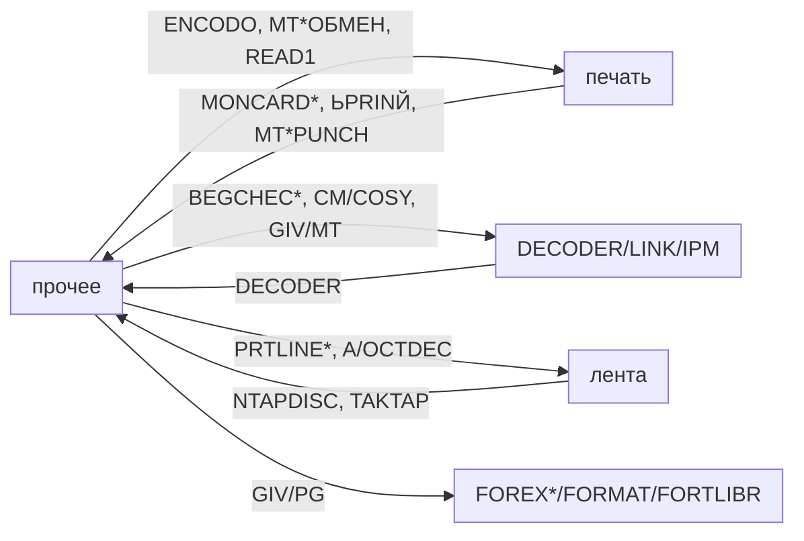

# 03 — Глобальный свод перекрёстных ссылок библиотеки 21

> **Автоматически сгенерировано** `tools/lib21_xref.py`. Не редактировать вручную —
> перегенерируйте командой из раздела «Воспроизводимость».

## 1. Метод и источники

Sym-секции всех объектных модулей образа `lib21.bin` разбираются напрямую:
каталог → DMS-заголовок → раздел `sym` (типы `EXT/ENTRY/DENTRY/COMMON/PRIVATE/ABS`)
→ категории МАДЛЕН `SUBP` / `LC` / `BSS` / `ENTRY`. Символические операнды
кода берутся из dtran-листингов `disasm/lib21/*.madlen`; имена и явные `,ENTRY,`
— из аннотированных текстов `src/lib21/*.mad` и `include/lib21/*.xref.md`.

| Показатель | Значение |
|---|---:|
| Модулей в sym-секциях | **358** |
| Записей каталога | 601 |
| Листингов dtran | 358 |
| Различных символов в sym-секциях | 871 |
| Внешних символов (SUBP / definition+use) | **401** |
| Символов-type SUBP | 866 |
| Рёбер графа «поставщик → потребитель» | 600 |
| Аннотированных имён (для проверки 6-символьного правила) | 3072 |

Источник: `/home/azizz/Yandex.Disk/besm6-new/DUBNA/BUILD/elements/lib21.bin`; sha256 `fa34cac9b4a96660ca9babf02f7a2231ca9209581882c343d6afd5a3a94b1161`.

## 2. Топ внешних символов по числу модулей

«Объявляют» — модули, в чьей sym-секции есть запись символа; «вызывают» —
модули с объявлением `SUBP` или символической ссылкой в коде. Ниже — символы,
задействованные более чем в одном модуле.

| Символ | Типы | Объявляют | Модули-объявители | Вызывают | Модули-вызывающие |
|---|---|---:|---|---:|---|
| `ЬERRMЙ` | SUBP | 43 | `SCHEND`, `ЬCLOSЙ`, `ЬCPARЙ`, `ЬIF2AЙ`, `ЬIF2BЙ`, `ЬIF2DЙ`, `ЬIF2IЙ`, `ЬIF2LЙ` … (+35) | 43 | `SCHEND`, `ЬCLOSЙ`, `ЬCPARЙ`, `ЬIF2AЙ`, `ЬIF2BЙ`, `ЬIF2DЙ`, `ЬIF2IЙ`, `ЬIF2LЙ` … (+35) |
| `PRINT8` | SUBP | 39 | `*DISPAR1`, `AVTOLOAD`, `BEMSH*`, `BIGTITLE`, `CHE*NAM`, `CHEKJOB*`, `COLLECT`, `CRELIB` … (+31) | 39 | `*DISPAR1`, `AVTOLOAD`, `BEMSH*`, `BIGTITLE`, `CHE*NAM`, `CHEKJOB*`, `COLLECT`, `CRELIB` … (+31) |
| `CЬVP` | ENTRY, SUBP | 38 | `CЬVP`, `VOБФOP`, `VVERPR`, `ЬCPARЙ`, `ЬDELSЙ`, `ЬIF2AЙ`, `ЬIF4AЙ`, `ЬIF4BЙ` … (+30) | 37 | `VOБФOP`, `VVERPR`, `ЬCPARЙ`, `ЬDELSЙ`, `ЬIF2AЙ`, `ЬIF4AЙ`, `ЬIF4BЙ`, `ЬIF4CЙ` … (+29) |
| `PARAMT*` | SUBP | 28 | `ALGOL//`, `AVTOLOAD`, `BEMTOMON`, `CHE*NAM`, `CHEKJOB*`, `COLLECT`, `COMTODRU`, `CRELIB` … (+20) | 28 | `ALGOL//`, `AVTOLOAD`, `BEMTOMON`, `CHE*NAM`, `CHEKJOB*`, `COLLECT`, `COMTODRU`, `CRELIB` … (+20) |
| `CЬMV` | ENTRY, SUBP | 23 | `CЬMV`, `VOБФOP`, `VVERPR`, `ЬCPARЙ`, `ЬIF2AЙ`, `ЬIF4AЙ`, `ЬIFAЙ`, `ЬINQFЙ` … (+15) | 22 | `VOБФOP`, `VVERPR`, `ЬCPARЙ`, `ЬIF2AЙ`, `ЬIF4AЙ`, `ЬIFAЙ`, `ЬINQFЙ`, `ЬIUCЙ` … (+14) |
| `CЬZB` | ENTRY, SUBP | 17 | `CЬZB`, `VVERPR`, `ЬCPARЙ`, `ЬIF2AЙ`, `ЬIF4AЙ`, `ЬIFAЙ`, `ЬINI1Й`, `ЬINOFЙ` … (+9) | 16 | `VVERPR`, `ЬCPARЙ`, `ЬIF2AЙ`, `ЬIF4AЙ`, `ЬIFAЙ`, `ЬINI1Й`, `ЬINOFЙ`, `ЬINQFЙ` … (+8) |
| `MONCARD*` | LC, SUBP | 18 | `*NEWTEX*`, `ALGOL//`, `ALPHA*`, `BBOДA0`, `CHEKJOB*`, `COLLECT`, `DISPAC`, `DMS/80` … (+10) | 10 | `BBOДA0`, `CHEKJOB*`, `COLLECT`, `MAK/FILE`, `MAKFIL/`, `MIXLOAD`, `OVERLOAD`, `PUTFLAG*` … (+2) |
| `BЬVP` | ENTRY, SUBP | 14 | `BЬVP`, `CVARAC`, `CЬVP`, `VOБФOP`, `VVERPR`, `ЬIF2BЙ`, `ЬIF4BЙ`, `ЬIFBЙ` … (+6) | 13 | `CVARAC`, `CЬVP`, `VOБФOP`, `VVERPR`, `ЬIF2BЙ`, `ЬIF4BЙ`, `ЬIFBЙ`, `ЬIUBЙ` … (+5) |
| `DATAPR*` | SUBP | 12 | `ALGOL//`, `ALPHA*`, `BEMTOMON`, `DOS/IAE`, `FOREX*`, `ITM/ASS`, `LINK/IPM`, `LISP` … (+4) | 12 | `ALGOL//`, `ALPHA*`, `BEMTOMON`, `DOS/IAE`, `FOREX*`, `ITM/ASS`, `LINK/IPM`, `LISP` … (+4) |
| `ЬCFMTЙ` | SUBP | 12 | `ЬIF2AЙ`, `ЬIF2BЙ`, `ЬIF2DЙ`, `ЬIF2IЙ`, `ЬIF2LЙ`, `ЬIF2RЙ`, `ЬOF2AЙ`, `ЬOF2BЙ` … (+4) | 12 | `ЬIF2AЙ`, `ЬIF2BЙ`, `ЬIF2DЙ`, `ЬIF2IЙ`, `ЬIF2LЙ`, `ЬIF2RЙ`, `ЬOF2AЙ`, `ЬOF2BЙ` … (+4) |
| `ЬCRЬ` | ENTRY, SUBP | 12 | `BЬAN`, `BЬNA`, `BЬNO`, `BЬNT`, `BЬNX`, `BЬOR`, `BЬXR`, `NЬUN` … (+4) | 11 | `BЬAN`, `BЬNA`, `BЬNO`, `BЬNT`, `BЬNX`, `BЬOR`, `BЬXR`, `NЬUN` … (+3) |
| `FT*002` | SUBP | 10 | `ANL`, `CVARAC`, `FM*002`, `FORMAT`, `INITMM`, `LUN`, `T*GOTO`, `T*INDX` … (+2) | 10 | `ANL`, `CVARAC`, `FM*002`, `FORMAT`, `INITMM`, `LUN`, `T*GOTO`, `T*INDX` … (+2) |
| `FT*003` | SUBP | 10 | `ANL`, `CVARAC`, `FORMAT`, `INITMM`, `LTX`, `LUN`, `T*GOTO`, `T*INDX` … (+2) | 10 | `ANL`, `CVARAC`, `FORMAT`, `INITMM`, `LTX`, `LUN`, `T*GOTO`, `T*INDX` … (+2) |
| `FT*571` | SUBP | 10 | `ANL`, `CVARAC`, `FORMAT`, `INITMM`, `LTX`, `LUN`, `T*GOTO`, `T*INDX` … (+2) | 10 | `ANL`, `CVARAC`, `FORMAT`, `INITMM`, `LTX`, `LUN`, `T*GOTO`, `T*INDX` … (+2) |
| `MONITOR*` | SUBP | 9 | `BEMSH*`, `CHEKJOB*`, `COLLECT`, `EXECUTE`, `LINK/IPM`, `MAKELIBT`, `MIXLOAD`, `OVERLOAD` … (+1) | 9 | `BEMSH*`, `CHEKJOB*`, `COLLECT`, `EXECUTE`, `LINK/IPM`, `MAKELIBT`, `MIXLOAD`, `OVERLOAD` … (+1) |
| `MONREAD*` | SUBP | 9 | `CHEKJOB*`, `COLLECT`, `DIPOL*`, `MAK/FILE`, `MAKFIL/`, `MIXLOAD`, `OVERLOAD`, `PUTFLAG*` … (+1) | 9 | `CHEKJOB*`, `COLLECT`, `DIPOL*`, `MAK/FILE`, `MAKFIL/`, `MIXLOAD`, `OVERLOAD`, `PUTFLAG*` … (+1) |
| `READ*` | SUBP | 9 | `BBOДA0`, `BEMSH*`, `DOS/IAE`, `LINK/IPM`, `MAK/FILE`, `MAKFIL/`, `SUMOVER`, `ЬCRDЙ` … (+1) | 9 | `BBOДA0`, `BEMSH*`, `DOS/IAE`, `LINK/IPM`, `MAK/FILE`, `MAKFIL/`, `SUMOVER`, `ЬCRDЙ` … (+1) |
| `ЬEXECЙ` | ENTRY, SUBP | 9 | `ЬEXECЙ`, `ЬINI2Й`, `ЬINIFЙ`, `ЬINO2Й`, `ЬINOFЙ`, `ЬPRINЙ`, `ЬPUNCЙ`, `ЬREADЙ` … (+1) | 8 | `ЬINI2Й`, `ЬINIFЙ`, `ЬINO2Й`, `ЬINOFЙ`, `ЬPRINЙ`, `ЬPUNCЙ`, `ЬREADЙ`, `ЬSTINЙ` |
| `ISO*TEX*` | SUBP | 8 | `CHE*NAM`, `CHEKJOB*`, `DOS/IAE`, `GIVETIME`, `MT*PUNCH`, `NTAPDISC`, `PUNTITLE`, `SUMOVER` | 8 | `CHE*NAM`, `CHEKJOB*`, `DOS/IAE`, `GIVETIME`, `MT*PUNCH`, `NTAPDISC`, `PUNTITLE`, `SUMOVER` |
| `STOP*` | SUBP | 8 | `COLLECT`, `CRELIB`, `EXECUTE`, `INITMM`, `MIXLOAD`, `OVERLOAD`, `PCPLOT`, `VVERPR` | 8 | `COLLECT`, `CRELIB`, `EXECUTE`, `INITMM`, `MIXLOAD`, `OVERLOAD`, `PCPLOT`, `VVERPR` |
| `CЬIN` | ENTRY, SUBP | 8 | `CЬIN`, `VOБФOP`, `ЬCPARЙ`, `ЬIF4AЙ`, `ЬIF4BЙ`, `ЬIF4CЙ`, `ЬIFBЙ`, `ЬOPNЙ` | 7 | `VOБФOP`, `ЬCPARЙ`, `ЬIF4AЙ`, `ЬIF4BЙ`, `ЬIF4CЙ`, `ЬIFBЙ`, `ЬOPNЙ` |
| `ЬCPABЬ` | ENTRY, SUBP | 8 | `BЬCPAB`, `CЬCPAB`, `ЬCPABЬ`, `ЬGEЬ`, `ЬGTЬ`, `ЬLEЬ`, `ЬLTЬ`, `ЬNEЬ` | 7 | `BЬCPAB`, `CЬCPAB`, `ЬGEЬ`, `ЬGTЬ`, `ЬLEЬ`, `ЬLTЬ`, `ЬNEЬ` |
| `ЬLDPRЙ` | ENTRY, SUBP | 8 | `ЬIF4AЙ`, `ЬIF4BЙ`, `ЬIF4CЙ`, `ЬIF4DЙ`, `ЬIF4IЙ`, `ЬIF4LЙ`, `ЬIF4RЙ`, `ЬLDPRЙ` | 7 | `ЬIF4AЙ`, `ЬIF4BЙ`, `ЬIF4CЙ`, `ЬIF4DЙ`, `ЬIF4IЙ`, `ЬIF4LЙ`, `ЬIF4RЙ` |
| `ЬNEXTЙ` | ENTRY, SUBP | 8 | `VOБФOP`, `ЬDELSЙ`, `ЬIFDЙ`, `ЬIFIЙ`, `ЬIFLЙ`, `ЬIFRЙ`, `ЬLDPRЙ`, `ЬNEXTЙ` | 7 | `VOБФOP`, `ЬDELSЙ`, `ЬIFDЙ`, `ЬIFIЙ`, `ЬIFLЙ`, `ЬIFRЙ`, `ЬLDPRЙ` |
| `LOADANGO` | SUBP | 7 | `ALGOL/SI`, `CRELIB`, `DOS/IAE`, `EXECUTE`, `FOREX*`, `LFSYST`, `ПYЛЬC` | 7 | `ALGOL/SI`, `CRELIB`, `DOS/IAE`, `EXECUTE`, `FOREX*`, `LFSYST`, `ПYЛЬC` |
| `PRINT8//` | SUBP | 7 | `BEMTOMON`, `DOS/IAE`, `LINK/IPM`, `PRINTFIL`, `PRTLINE*`, `SERWISM`, `TCATALOG` | 7 | `BEMTOMON`, `DOS/IAE`, `LINK/IPM`, `PRINTFIL`, `PRTLINE*`, `SERWISM`, `TCATALOG` |
| `BЬMV` | ENTRY, SUBP | 7 | `BЬBIT`, `BЬMV`, `CVARAC`, `IЬBIT`, `ЬIFBЙ`, `ЬIUBЙ`, `ЬOUBЙ` | 6 | `BЬBIT`, `CVARAC`, `IЬBIT`, `ЬIFBЙ`, `ЬIUBЙ`, `ЬOUBЙ` |
| `DRUMTAP*` | SUBP | 6 | `MT*PUNCH`, `READ1`, `READ2`, `REDACT2`, `TAKECRD*`, `WRITE1` | 6 | `MT*PUNCH`, `READ1`, `READ2`, `REDACT2`, `TAKECRD*`, `WRITE1` |
| `PT6/G` | SUBP | 6 | `CRELIB`, `LIBDRU*`, `LIBTAP*`, `LOADLIBR`, `MAKELIBT`, `SUMOVER` | 6 | `CRELIB`, `LIBDRU*`, `LIBTAP*`, `LOADLIBR`, `MAKELIBT`, `SUMOVER` |
| `ЬENDMЙ` | SUBP | 6 | `ЬCRDЙ`, `ЬINI1Й`, `ЬINI2Й`, `ЬINRЙ`, `ЬIUWЙ`, `ЬREADЙ` | 6 | `ЬCRDЙ`, `ЬINI1Й`, `ЬINI2Й`, `ЬINRЙ`, `ЬIUWЙ`, `ЬREADЙ` |
| `ЬNXTЙ` | SUBP | 6 | `VOБФOP`, `ЬIFDЙ`, `ЬIFIЙ`, `ЬIFLЙ`, `ЬIFRЙ`, `ЬLDPRЙ` | 6 | `VOБФOP`, `ЬIFDЙ`, `ЬIFIЙ`, `ЬIFLЙ`, `ЬIFRЙ`, `ЬLDPRЙ` |
| `ЬOF1NЙ` | SUBP | 6 | `ЬOF4AЙ`, `ЬOF4BЙ`, `ЬOF4CЙ`, `ЬTRMFЙ`, `ЬTRMЙ`, `ЬTSLNЙ` | 6 | `ЬOF4AЙ`, `ЬOF4BЙ`, `ЬOF4CЙ`, `ЬTRMFЙ`, `ЬTRMЙ`, `ЬTSLNЙ` |
| `ЬQVTЙ` | SUBP | 6 | `VVERPR`, `ЬINI2Й`, `ЬINO2Й`, `ЬINOFЙ`, `ЬINQUЙ`, `ЬOPNЙ` | 6 | `VVERPR`, `ЬINI2Й`, `ЬINO2Й`, `ЬINOFЙ`, `ЬINQUЙ`, `ЬOPNЙ` |
| `A/OCTDEC` | ENTRY, SUBP | 6 | `A/OCTDEC`, `BEMTOMON`, `CRELIB`, `LIBTAP*`, `MAKELIBT`, `SERWISM` | 5 | `BEMTOMON`, `CRELIB`, `LIBTAP*`, `MAKELIBT`, `SERWISM` |
| `BЬCPAB` | ENTRY, SUBP | 6 | `BЬCPAB`, `BЬGE`, `BЬGT`, `BЬLE`, `BЬLT`, `BЬNE` | 5 | `BЬGE`, `BЬGT`, `BЬLE`, `BЬLT`, `BЬNE` |
| `CЬCPAB` | ENTRY, SUBP | 6 | `CЬCPAB`, `CЬGE`, `CЬGT`, `CЬLE`, `CЬLT`, `CЬNE` | 5 | `CЬGE`, `CЬGT`, `CЬLE`, `CЬLT`, `CЬNE` |
| `MT*OБMEH` | ENTRY, SUBP | 6 | `MT*OБMEH`, `MT/БИБ`, `PRINTFIL`, `REDACT1`, `REDACT2`, `REDACTRM` | 5 | `MT/БИБ`, `PRINTFIL`, `REDACT1`, `REDACT2`, `REDACTRM` |
| `SWRITE` | ENTRY, SUBP | 6 | `SWRITE`, `ЬINO2Й`, `ЬONRЙ`, `ЬOUBЙ`, `ЬOUCЙ`, `ЬOUWЙ` | 5 | `ЬINO2Й`, `ЬONRЙ`, `ЬOUBЙ`, `ЬOUCЙ`, `ЬOUWЙ` |
| `TABLE2*` | ENTRY, SUBP | 6 | `BEGCHEC*`, `INPUTCAL`, `PUNM220`, `PUNUPP`, `TABLE2*`, `UPPFILE` | 5 | `BEGCHEC*`, `INPUTCAL`, `PUNM220`, `PUNUPP`, `UPPFILE` |
| `ЬDMU3Й` | ENTRY, SUBP | 6 | `ЬDMU3Й`, `ЬIFDЙ`, `ЬIFRЙ`, `ЬMP10Й`, `ЬOFDЙ`, `ЬOFIЙ` | 5 | `ЬIFDЙ`, `ЬIFRЙ`, `ЬMP10Й`, `ЬOFDЙ`, `ЬOFIЙ` |
| `ЬINLDЙ` | ENTRY, SUBP | 6 | `TЬCALL`, `TЬGOTO`, `TЬINDX`, `TЬPARR`, `TЬRPL`, `ЬINLDЙ` | 5 | `TЬCALL`, `TЬGOTO`, `TЬINDX`, `TЬPARR`, `TЬRPL` |
| `ЬOF4AЙ` | ENTRY, SUBP | 6 | `TЬCALL`, `TЬGOTO`, `TЬINDX`, `TЬPARR`, `TЬRPL`, `ЬOF4AЙ` | 5 | `TЬCALL`, `TЬGOTO`, `TЬINDX`, `TЬPARR`, `TЬRPL` |
| `ЬPRINЙ` | ENTRY, SUBP | 6 | `TЬCALL`, `TЬGOTO`, `TЬINDX`, `TЬPARR`, `TЬRPL`, `ЬPRINЙ` | 5 | `TЬCALL`, `TЬGOTO`, `TЬINDX`, `TЬPARR`, `TЬRPL` |
| `ЬTRMFЙ` | ENTRY, SUBP | 6 | `TЬCALL`, `TЬGOTO`, `TЬINDX`, `TЬPARR`, `TЬRPL`, `ЬTRMFЙ` | 5 | `TЬCALL`, `TЬGOTO`, `TЬINDX`, `TЬPARR`, `TЬRPL` |
| `ЬUNITЙ` | ENTRY, SUBP | 6 | `SCHEND`, `ЬINIFЙ`, `ЬINOFЙ`, `ЬIUWЙ`, `ЬOUWЙ`, `ЬUNITЙ` | 5 | `SCHEND`, `ЬINIFЙ`, `ЬINOFЙ`, `ЬIUWЙ`, `ЬOUWЙ` |
| `ЬЗПЬ` | ENTRY, SUBP | 6 | `BЬAN`, `BЬNT`, `BЬOR`, `BЬXR`, `ЬMVЬ`, `ЬЗПЬ` | 5 | `BЬAN`, `BЬNT`, `BЬOR`, `BЬXR`, `ЬMVЬ` |
| `BLEXPRIN` | SUBP | 5 | `COLLECT`, `CRELIB`, `EXECUTE`, `MIXLOAD`, `OVERLOAD` | 5 | `COLLECT`, `CRELIB`, `EXECUTE`, `MIXLOAD`, `OVERLOAD` |
| `ISOPRT*` | SUBP | 5 | `DUMP`, `DUMP1`, `F/LOOP`, `F/TRACE`, `PRTLOC*` | 5 | `DUMP`, `DUMP1`, `F/LOOP`, `F/TRACE`, `PRTLOC*` |
| `LOADGO` | SUBP | 5 | `*NEWTEX*`, `AHAЛИTИK`, `CHEKJOB*`, `DIPOL*`, `ЬINERЙ` | 5 | `*NEWTEX*`, `AHAЛИTИK`, `CHEKJOB*`, `DIPOL*`, `ЬINERЙ` |
| `NEWLINE*` | SUBP | 5 | `DUMP`, `DUMP1`, `F/LOOP`, `F/TRACE`, `PRTLOC*` | 5 | `DUMP`, `DUMP1`, `F/LOOP`, `F/TRACE`, `PRTLOC*` |
| `SREAD` | SUBP | 5 | `ЬINI2Й`, `ЬINRЙ`, `ЬIUBЙ`, `ЬIUCЙ`, `ЬIUWЙ` | 5 | `ЬINI2Й`, `ЬINRЙ`, `ЬIUBЙ`, `ЬIUCЙ`, `ЬIUWЙ` |
| `ЬCMЬ` | SUBP | 5 | `ЬGEЬ`, `ЬGTЬ`, `ЬLEЬ`, `ЬLTЬ`, `ЬNEЬ` | 5 | `ЬGEЬ`, `ЬGTЬ`, `ЬLEЬ`, `ЬLTЬ`, `ЬNEЬ` |
| `ЬNUMBЙ` | SUBP | 5 | `VOБФOP`, `ЬIFDЙ`, `ЬIFIЙ`, `ЬIFRЙ`, `ЬLDPRЙ` | 5 | `VOБФOP`, `ЬIFDЙ`, `ЬIFIЙ`, `ЬIFRЙ`, `ЬLDPRЙ` |
| `CHE*NAM` | ENTRY, SUBP | 5 | `CHE*NAM`, `CHEKJOB*`, `INPUTCAL`, `MT*BATCH`, `ORDERS*` | 4 | `CHEKJOB*`, `INPUTCAL`, `MT*BATCH`, `ORDERS*` |
| `NTAPDISC` | ENTRY, SUBP | 5 | `AVTOLOAD`, `CHE*NAM`, `CHEKJOB*`, `DOS/IAE`, `NTAPDISC` | 4 | `AVTOLOAD`, `CHE*NAM`, `CHEKJOB*`, `DOS/IAE` |
| `PRTLINE*` | ENTRY, SUBP | 5 | `DUMP`, `DUMP1`, `F/LOOP`, `PRTLINE*`, `PRTLOC*` | 4 | `DUMP`, `DUMP1`, `F/LOOP`, `PRTLOC*` |
| `TEXISO` | ENTRY, SUBP | 5 | `CM/COSY`, `LOADLIBR`, `REDACTRM`, `STATSUM`, `TEXISO` | 4 | `CM/COSY`, `LOADLIBR`, `REDACTRM`, `STATSUM` |
| `ЬMP10Й` | ENTRY, SUBP | 5 | `ЬIFDЙ`, `ЬIFRЙ`, `ЬMP10Й`, `ЬOFDЙ`, `ЬOFIЙ` | 4 | `ЬIFDЙ`, `ЬIFRЙ`, `ЬOFDЙ`, `ЬOFIЙ` |
| `ЬOF2IЙ` | ENTRY, SUBP | 5 | `TЬGOTO`, `TЬINDX`, `TЬPARR`, `TЬRPL`, `ЬOF2IЙ` | 4 | `TЬGOTO`, `TЬINDX`, `TЬPARR`, `TЬRPL` |
| `ЬOF4BЙ` | ENTRY, SUBP | 5 | `TЬGOTO`, `TЬINDX`, `TЬPARR`, `TЬRPL`, `ЬOF4BЙ` | 4 | `TЬGOTO`, `TЬINDX`, `TЬPARR`, `TЬRPL` |

Полный список — `--json <путь>` (раздел `symbols`).

## 3. Граф зависимостей

Ребро «объявитель/поставщик → потребитель» проводится, когда символ,
объявленный (или являющийся entry) в модуле A, используется в модуле B.
Кластеры: `FOREX*/FORMAT/FORTLIBR` (ядро и рантайм), `DECODER/LINK/IPM`,
печать и лента. Ниже — рёбра между кластерами (по числу общих символов).



Ключевые рёбра «модуль → модуль» (не только между кластерами):

| Поставщик | Потребитель | Символы |
|---|---|---|
| `*DISPAR1` | `CHEKJOB*` | `*DISPAR1` |
| `*NEWTEX*` | `BBOДA0` | `MONCARD*` |
| `*NEWTEX*` | `CHEKJOB*` | `MONCARD*` |
| `*NEWTEX*` | `COLLECT` | `MONCARD*` |
| `*NEWTEX*` | `MAK/FILE` | `MONCARD*` |
| `*NEWTEX*` | `MAKFIL/` | `MONCARD*` |
| `*NEWTEX*` | `MIXLOAD` | `MONCARD*` |
| `*NEWTEX*` | `OVERLOAD` | `MONCARD*` |
| `*NEWTEX*` | `PUTFLAG*` | `MONCARD*` |
| `*NEWTEX*` | `ЬCRDЙ` | `MONCARD*` |
| `*NEWTEX*` | `ЬREADЙ` | `MONCARD*` |
| `*ПEPФOPA` | `REDACTRM` | `*ПEPФOPA` |
| `A/OCTDEC` | `BEMTOMON` | `A/OCTDEC` |
| `A/OCTDEC` | `CRELIB` | `A/OCTDEC` |
| `A/OCTDEC` | `LIBTAP*` | `A/OCTDEC` |
| `A/OCTDEC` | `MAKELIBT` | `A/OCTDEC` |
| `A/OCTDEC` | `SERWISM` | `A/OCTDEC` |
| `ALGOL//` | `BBOДA0` | `MONCARD*` |
| `ALGOL//` | `CHEKJOB*` | `MONCARD*` |
| `ALGOL//` | `COLLECT` | `MONCARD*` |
| `ALGOL//` | `MAK/FILE` | `MONCARD*` |
| `ALGOL//` | `MAKFIL/` | `MONCARD*` |
| `ALGOL//` | `MIXLOAD` | `MONCARD*` |
| `ALGOL//` | `OVERLOAD` | `MONCARD*` |
| `ALGOL//` | `PUTFLAG*` | `MONCARD*` |
| `ALGOL//` | `ЬCRDЙ` | `MONCARD*` |
| `ALGOL//` | `ЬREADЙ` | `MONCARD*` |
| `ALPHA*` | `BBOДA0` | `MONCARD*` |
| `ALPHA*` | `CHEKJOB*` | `MONCARD*` |
| `ALPHA*` | `COLLECT` | `MONCARD*` |
| `ALPHA*` | `MAK/FILE` | `MONCARD*` |
| `ALPHA*` | `MAKFIL/` | `MONCARD*` |
| `ALPHA*` | `MIXLOAD` | `MONCARD*` |
| `ALPHA*` | `OVERLOAD` | `MONCARD*` |
| `ALPHA*` | `PUTFLAG*` | `MONCARD*` |
| `ALPHA*` | `ЬCRDЙ` | `MONCARD*` |
| `ALPHA*` | `ЬREADЙ` | `MONCARD*` |
| `BBOДA0` | `CHEKJOB*` | `MONCARD*` |
| `BBOДA0` | `COLLECT` | `MONCARD*` |
| `BBOДA0` | `ITM/ASS` | `BBOДA0` |
| `BBOДA0` | `LISP` | `BBOДA0` |
| `BBOДA0` | `MAK/FILE` | `MONCARD*` |
| `BBOДA0` | `MAKFIL/` | `MONCARD*` |
| `BBOДA0` | `MIXLOAD` | `MONCARD*` |
| `BBOДA0` | `OVERLOAD` | `MONCARD*` |
| `BBOДA0` | `PUTFLAG*` | `MONCARD*` |
| `BBOДA0` | `ЬCRDЙ` | `MONCARD*` |
| `BBOДA0` | `ЬREADЙ` | `MONCARD*` |
| `BEGBATCH` | `INPUTCAL` | `BEGBATCH` |
| `BEGCHEC*` | `DECODER` | `BEGCHEC*` |
| … | … | ещё 550 рёбер |

### 3.1 Ключевые символы кластеров

Сводка по символам, связывающим ядро (`FOREX*`, `FORMAT`, `FORTLIBR`)
с decoder/link/IPM, печатью и лентой. «Объявители» — из sym-секции,
«вызывающие» — SUBP-объявления и символические ссылки в коде.

| Символ | Кластеры-пользователи | Объявители | Вызывающие (пример) |
|---|---|---|---|
| `FT*571` | FOREX*/FORMAT/FORTLIBR, прочее | `ANL`, `CVARAC`, `FORMAT`, `INITMM` … (+6) | `ANL`, `CVARAC`, `FORMAT`, `INITMM` … (+6) |
| `FT*003` | FOREX*/FORMAT/FORTLIBR, прочее | `ANL`, `CVARAC`, `FORMAT`, `INITMM` … (+6) | `ANL`, `CVARAC`, `FORMAT`, `INITMM` … (+6) |
| `PRINT8` | FOREX*/FORMAT/FORTLIBR, лента, печать, прочее | `*DISPAR1`, `AVTOLOAD`, `BEMSH*`, `BIGTITLE` … (+35) | `*DISPAR1`, `AVTOLOAD`, `BEMSH*`, `BIGTITLE` … (+35) |
| `PRINT8//` | DECODER/LINK/IPM, печать, прочее | `BEMTOMON`, `DOS/IAE`, `LINK/IPM`, `PRINTFIL` … (+3) | `BEMTOMON`, `DOS/IAE`, `LINK/IPM`, `PRINTFIL` … (+3) |
| `DATAPR*` | DECODER/LINK/IPM, FOREX*/FORMAT/FORTLIBR, прочее | `ALGOL//`, `ALPHA*`, `BEMTOMON`, `DOS/IAE` … (+8) | `ALGOL//`, `ALPHA*`, `BEMTOMON`, `DOS/IAE` … (+8) |
| `GIV/PG` | FOREX*/FORMAT/FORTLIBR, прочее | `FOREX*`, `GIV/PG` | `FOREX*` |
| `TAK/PG` | FOREX*/FORMAT/FORTLIBR | `FOREX*` | `FOREX*` |
| `OCTTDEC` | DECODER/LINK/IPM, FOREX*/FORMAT/FORTLIBR, прочее | `DECODER`, `FOREX*`, `TCATALOG` | `DECODER`, `FOREX*`, `TCATALOG` |
| `LOADANGO` | FOREX*/FORMAT/FORTLIBR, прочее | `ALGOL/SI`, `CRELIB`, `DOS/IAE`, `EXECUTE` … (+3) | `ALGOL/SI`, `CRELIB`, `DOS/IAE`, `EXECUTE` … (+3) |
| `MONITOR*` | DECODER/LINK/IPM, прочее | `BEMSH*`, `CHEKJOB*`, `COLLECT`, `EXECUTE` … (+5) | `BEMSH*`, `CHEKJOB*`, `COLLECT`, `EXECUTE` … (+5) |
| `MONREAD*` | прочее | `CHEKJOB*`, `COLLECT`, `DIPOL*`, `MAK/FILE` … (+5) | `CHEKJOB*`, `COLLECT`, `DIPOL*`, `MAK/FILE` … (+5) |
| `READ*` | DECODER/LINK/IPM, прочее | `BBOДA0`, `BEMSH*`, `DOS/IAE`, `LINK/IPM` … (+5) | `BBOДA0`, `BEMSH*`, `DOS/IAE`, `LINK/IPM` … (+5) |
| `DRUMTAP*` | печать, прочее | `MT*PUNCH`, `READ1`, `READ2`, `REDACT2` … (+2) | `MT*PUNCH`, `READ1`, `READ2`, `REDACT2` … (+2) |
| `DECODER` | DECODER/LINK/IPM, прочее | `DECODER`, `INPUT*` | `INPUT*` |
| `LINK/IPM` | DECODER/LINK/IPM | `LINK/IPM` | — |
| `PARAMT*` | лента, прочее | `ALGOL//`, `AVTOLOAD`, `BEMTOMON`, `CHE*NAM` … (+24) | `ALGOL//`, `AVTOLOAD`, `BEMTOMON`, `CHE*NAM` … (+24) |
| `ISO*TEX*` | лента, печать, прочее | `CHE*NAM`, `CHEKJOB*`, `DOS/IAE`, `GIVETIME` … (+4) | `CHE*NAM`, `CHEKJOB*`, `DOS/IAE`, `GIVETIME` … (+4) |
| `BUFFER` | FOREX*/FORMAT/FORTLIBR, печать, прочее | `*DISPAR1`, `CO*BATCH`, `FORTLIBR`, `GIVETIME` … (+8) | `CO*BATCH`, `FORTLIBR`, `GIVETIME`, `PRI*NEWS` … (+5) |

## 4. Модуль → entry → внешние ссылки

`entry` — имя модуля (символ `NAME`) плюс явные объявления `,ENTRY,`. 
Внешние ссылки — `SUBP`-объявления sym-секции.

| Модуль | Entry | Внешние ссылки (SUBP) |
|---|---|---|
| `*DISPAR1` | `*DISPAR1` | `PRINT8`, `TOMAN*` |
| `*DRIVER*` | `*DRIVER*` | — |
| `*ICHECK*` | `*ICHECK*` | — |
| `*NEWTEX*` | `*NEWTEX*` | `LOADGO` |
| `*SPEC` | `*SPEC` | — |
| `*ПEPФOPA` | `*ПEPФOPA` | — |
| `*ЬDP10Й*` | `*ЬDP10Й*` | — |
| `*ЬIOCBЙ*` | `*ЬIOCBЙ*` | — |
| `/NOOPT` | `/NOOPT` | — |
| `A/OCTDEC` | `A/OCTDEC` | — |
| `AHAЛИTИK` | `AHAЛИTИK` | `ALLMEMOR`, `LOADGO`, `MAK/FILE`, `UPPFILE`, `Э60/MБ` |
| `ALGOL//` | `ALGOL//` | `DATAPR*`, `ISOTOA0`, `PARAMT*` |
| `ALGOL/SI` | `ALGOL/SI` | `LOADANGO` |
| `ALPHA*` | `ALPHA*` | `DATAPR*` |
| `ANL` | `ANL` | `FT*002`, `FT*003`, `FT*571`, `IFZ`, `LUN`, `NOZ`, `ZONE` |
| `AVTOLOAD` | `AVTOLOAD` | `NTAPDISC`, `PARAMT*`, `PRINT8` |
| `B6TOPC` | `B6TOPC` | `F/SNOSV`, `F/SRETNR`, `PCBEG`, `PCEND`, `PCREAD`, `PCWRIT`, `R*TO*INT` |
| `BBOДA0` | `BBOДA0` | `READ*` |
| `BEGBATCH` | `BEGBATCH` | — |
| `BEGCHEC*` | `BEGCHEC*` | `TABLE2*` |
| `BEGTPR` | `BEGTPR` | `GIVE100` |
| `BEMSH*` | `BEMSH*` | `GIV/MT`, `MONITOR*`, `PRINT8`, `READ*`, `БEMШ/ПAP` |
| `BEMTOMON` | `BEMTOMON` | `A/OCTDEC`, `DATAPR*`, `PARAMT*`, `PRINT8//`, `WBEGIN`, `WRCARD`, `WRIEND` |
| `BIB` | `BIB` | `WRITE1` |
| `BIGTITLE` | `BIGTITLE` | `PRINT8` |
| `BЬAN` | `BЬAN` | `ЬCRЬ`, `ЬЗПЬ` |
| `BЬBIT` | `BЬBIT` | `BЬMV` |
| `BЬCPAB` | `BЬCPAB` | `ЬCPABЬ` |
| `BЬGE` | `BЬGE` | `BЬCPAB` |
| `BЬGT` | `BЬGT` | `BЬCPAB` |
| `BЬIN` | `BЬIN` | `ЬINЬ` |
| `BЬLE` | `BЬLE` | `BЬCPAB` |
| `BЬLT` | `BЬLT` | `BЬCPAB` |
| `BЬMV` | `BЬMV` | `ЬMVЬ` |
| `BЬNA` | `BЬNA` | `BЬAN`, `ЬCRЬ` |
| `BЬNE` | `BЬNE` | `BЬCPAB` |
| `BЬNO` | `BЬNO` | `BЬOR`, `ЬCRЬ` |
| `BЬNT` | `BЬNT` | `ЬCRЬ`, `ЬЗПЬ` |
| `BЬNX` | `BЬNX` | `BЬXR`, `ЬCRЬ` |
| `BЬOR` | `BЬOR` | `ЬCRЬ`, `ЬЗПЬ` |
| `BЬVP` | `BЬVP` | `ЬCN48Ь` |
| `BЬXR` | `BЬXR` | `ЬCRЬ`, `ЬЗПЬ` |
| `BЬZB` | `BЬZB` | `ЬMVЬ`, `ЬZZЬ` |
| `CAT` | `CAT` | `RECO` |
| `CHE*NAM` | `CHE*NAM` | `GIVETIME`, `ISO*TEX*`, `LIBRARY/`, `NTAPDISC`, `PARAMT*`, `PRINT8` |
| `CHEKJOB*` | `CHEKJOB*` | `*DISPAR1`, `BIGTITLE`, `CHE*NAM`, `CONCAR`, `END*CJOB`, `GIVETAP*`, `GIVETIME`, `GOST/ISO` … (+13) |
| `CM*002` | `CM*002` | `FC*002`, `FM*000` |
| `CM/COSY` | `CM/COSY` | `CHECKSUM`, `TEXISO` |
| `CO*BATCH` | `CO*BATCH` | `COSYTISO`, `ORDERS*` |
| `COLLECT` | `COLLECT` | `BLEXPRIN`, `LIBDELET`, `LISTLIBT`, `MONITOR*`, `MONREAD*`, `NEW//MON`, `NEWLIBR/`, `PARAMT*` … (+4) |
| `COMTODRU` | `COMTODRU` | `PARAMT*` |
| `CRELIB` | `CRELIB` | `A/OCTDEC`, `BLEXPRIN`, `LOADANGO`, `PARAMT*`, `PRINT8`, `PT6/G`, `STOP*` |
| `CSF` | `CSF` | — |
| `CTIME` | `CTIME` | — |
| `CUTCAT*` | `CUTCAT*` | — |
| `CVARAC` | `CVARAC` | `BЬMV`, `BЬVP`, `BЬZB`, `FT*002`, `FT*003`, `FT*571`, `LЬBIT` |
| `CЬCPAB` | `CЬCPAB` | `ЬCPABЬ` |
| `CЬGE` | `CЬGE` | `CЬCPAB` |
| `CЬGT` | `CЬGT` | `CЬCPAB` |
| `CЬIN` | `CЬIN` | `ЬINЬ` |
| `CЬLE` | `CЬLE` | `CЬCPAB` |
| `CЬLT` | `CЬLT` | `CЬCPAB` |
| `CЬMV` | `CЬMV` | `ЬMV8Ь` |
| `CЬNE` | `CЬNE` | `CЬCPAB` |
| `CЬVP` | `CЬVP` | `BЬVP` |
| `CЬZB` | `CЬZB` | `ЬBBЬ`, `ЬMV8Ь` |
| `DECODER` | `DECODER` | `BEGCHEC*`, `CHECCOD*`, `CM/COSY`, `COSY*`, `ERRCDC*`, `ERRSTA*`, `ERRUPP*`, `ERRYПДK*` … (+1) |
| `DIPOL*` | `DIPOL*` | `ALLMEMOR`, `EXECUTE`, `LOADGO`, `MONREAD*`, `TEROUT` |
| `DIR` | `DIR` | — |
| `DISPAC` | `DISPAC` | — |
| `DISPACER` | `DISPACER` | `PARAMT*` |
| `DM*002` | `DM*002` | `FD*002`, `FM*000` |
| `DMS/80` | `DMS/80` | — |
| `DOS/IAE` | `DOS/IAE` | `DATAPR*`, `EQUCRDL*`, `ISO*TEX*`, `LOADANGO`, `MNPLOUT`, `NAMTONUM`, `NTAPDISC`, `PARAMT*` … (+6) |
| `DUMP` | `DUMP` | `ADRPRT*`, `ISOPRT*`, `NEWLINE*`, `OCTPRT*`, `PRTLINE*`, `PUTBL*`, `PUTEWRD*` |
| `DUMP1` | `DUMP1` | `ADRPRT*`, `DUMP`, `ISOPRT*`, `KOMAF`, `NEWLINE*`, `PRTLINE*` |
| `EDI` | `EDI` | — |
| `ENCODO` | `ENCODO` | — |
| `EQUCRDL*` | `EQUCRDL*` | `SIMFAIL*` |
| `ERROR*P` | `ERROR*P` | — |
| `EXCLUDE` | `EXCLUDE` | — |
| `EXECUTE` | `EXECUTE` | `BLEXPRIN`, `LOADANGO`, `MONITOR*`, `PARAMT*`, `PRINT8`, `STOP*` |
| `F/LOOP` | `F/LOOP` | `ADRPRT*`, `ISOPRT*`, `NEWLINE*`, `PRTLINE*` |
| `F/PT6` | `F/PT6` | — |
| `F/TRACE` | `F/TRACE` | `ADRPRT*`, `F/PT6`, `INTPRTV*`, `ISOPRT*`, `NEWLINE*`, `OCTPRT*`, `PRINT8`, `PRTLINE/` … (+2) |
| `FINISHER` | `FINISHER` | `REVISOR*` |
| `FM*000` | `FM*000` | `PRINT8` |
| `FM*002` | `FM*002` | `FM*000`, `FT*002` |
| `FM*722` | `FM*722` | `FMRTAPE` |
| `FOR` | `FOR` | — |
| `FOREWORD` | `FOREWORD` | — |
| `FOREX*` | `FOREX*` | `COMEQ`, `CONST`, `DATAPR*`, `FOREX`, `GIV/PG`, `LOADANGO`, `OCTTDEC`, `OPRTR` … (+2) |
| `FORMAT` | `FORMAT` | `FT*002`, `FT*003`, `FT*521`, `FT*531`, `FT*541`, `FT*561`, `FT*571`, `FT*611` … (+3) |
| `FORTLIBR` | `FORTLIBR` | `PRINT8`, `WRITLIBR` |
| `FT*REGIM` | `FT*REGIM` | `PARAMT*`, `PRINT8` |
| `FTNPRT` | `FTNPRT` | `PRINT8` |
| `FTNPRT*` | `FTNPRT*` | `F/PT6` |
| `GIV/MT` | `GIV/MT` | `БEMШ/ПAP` |
| `GIV/PG` | `GIV/PG` | — |
| `GIVE100` | `GIVE100` | — |
| `GIVETIME` | `GIVETIME` | `ISO*TEX*`, `SE*10/US`, `TRANSFIO` |
| `GOST/ISO` | `GOST/ISO` | — |
| `HAЗMЛ` | `HAЗMЛ` | `COPYCARD`, `ISOTOA0`, `PARAMT*` |
| `IFIX` | `IFIX` | `*MISTAKE` |
| `IFZ` | `IFZ` | `CAT`, `DIR`, `FOR`, `LTX`, `PRO` |
| `INITMM` | `INITMM` | `FT*002`, `FT*003`, `FT*571`, `STOP*` |
| `INPUT*` | `INPUT*` | `DECODER`, `INITCODE` |
| `INPUTCAL` | `INPUTCAL` | `BEGBATCH`, `CHE*NAM`, `CHEKJOB*`, `CO*BATCH`, `CONBATCH`, `INITTAKE`, `INPUT*`, `MT*BATCH` … (+6) |
| `INTPRT2*` | `INTPRT2*` | `FTNPRT*`, `INTPRT*` |
| `IPCINI` | `IPCINI` | — |
| `IPCSND` | `IPCSND` | — |
| `ISOTOA0` | `ISOTOA0` | — |
| `ITCONB` | `ITCONB` | `BIN/EXCH`, `COM/MOD`, `CON/DIS` |
| `ITM/ASS` | `ITM/ASS` | `BBOДA0`, `DATAPR*`, `PARAMT*`, `START/ЧK` |
| `IЬANY` | `IЬANY` | `ЬANYЬ` |
| `IЬBIT` | `IЬBIT` | `BЬMV`, `ЬЦ0Ь` |
| `IЬCHAR` | `IЬCHAR` | `ЬLIBCЬ`, `ЬЦ0Ь` |
| `KILLBLAN` | `KILLBLAN` | — |
| `LDSHIFT` | `LDSHIFT` | — |
| `LFSCAN` | `LFSCAN` | `BCDWRIT*`, `F/SRET`, `F/SSTART`, `IGETS`, `IOCONT*`, `IOCTAL`, `IOEND*`, `IPUTS` … (+7) |
| `LFSYST` | `LFSYST` | `LOADANGO` |
| `LIBDRU*` | `LIBDRU*` | `PARAMT*`, `PRINT8`, `PT6/G` |
| `LIBLIST` | `LIBLIST` | — |
| `LIBRARY/` | `LIBRARY/` | `PARAMT*` |
| `LIBTAP*` | `LIBTAP*` | `A/OCTDEC`, `PARAMT*`, `PRINT8`, `PT6/G` |
| `LINE` | `LINE` | — |
| `LINK/IPM` | `LINK/IPM` | `DATAPR*`, `GIV/MT`, `MONITOR*`, `PRINT8//`, `READ*`, `БEMШ/ПAP` |
| `LISP` | `LISP` | `BBOДA0`, `DATAPR*` |
| `LOADI*0` | `LOADI*0` | `LOADLIBR` |
| `LOADLIBR` | `LOADLIBR` | `ENDSTAT`, `HAЛEHTY`, `NEW/30`, `OC/БЭCM6`, `OLD/30`, `PT6/G`, `REFUSE`, `SAVELIST` … (+4) |
| `LOADSTL` | `LOADSTL` | `PARAMT*`, `PRINPART`, `STATICLO` |
| `LTX` | `LTX` | `CSF`, `CSP`, `EDI`, `FT*003`, `FT*571`, `LINE`, `PAK`, `PAS` |
| `LUN` | `LUN` | `CSP`, `FT*002`, `FT*003`, `FT*571`, `IZ`, `LINE`, `PAK`, `PAS` |
| `LUNTYP` | `LUNTYP` | — |
| `LЬBIT` | `LЬBIT` | `ЬLIBCЬ`, `ЬTRUЬ` |
| `M220` | `M220` | `BINARY` |
| `MAK/FILE` | `MAK/FILE` | `MONREAD*`, `READ*`, `UPPFILE`, `WRIBINC` |
| `MAKELIBT` | `MAKELIBT` | `A/OCTDEC`, `EXCLUDE`, `MONITOR*`, `PARAMT*`, `PRINT8`, `PT6/G` |
| `MAKFIL/` | `MAKFIL/` | `MONREAD*`, `READ*`, `TEMFILE`, `TWRBINC` |
| `MIXLOAD` | `MIXLOAD` | `BLEXPRIN`, `MONITOR*`, `MONREAD*`, `NEWLIBR/`, `PARAMT*`, `PRINT8`, `STOP*` |
| `MT*BATCH` | `MT*BATCH` | `CHE*NAM`, `CO*BATCH`, `FINISHER`, `ORDERS*`, `PRINT8` |
| `MT*OБMEH` | `MT*OБMEH` | `ERMTRED` |
| `MT*PUNCH` | `MT*PUNCH` | `COLPUN*B`, `COLPUNB*`, `COLPUNC*`, `COLPUNE*`, `COSYTISO`, `DRUMTAP*`, `ISO*TEX*`, `PUNCTABL` … (+2) |
| `MT/RED` | `MT/RED` | `PARAMT*` |
| `MT/БИБ` | `MT/БИБ` | `MT*OБMEH`, `PRINT8` |
| `N8T10S` | `N8T10S` | — |
| `NTAPDISC` | `NTAPDISC` | `ISO*TEX*`, `MANTO*`, `PARAMT*`, `TABSIMIS` |
| `NЬANY` | `NЬANY` | `ЬANYЬ` |
| `NЬUN` | `NЬUN` | `ЬCRЬ`, `ЬЦ0Ь` |
| `OC/БЭCM6` | `OC/БЭCM6` | `LOADLIBR` |
| `OCATALOG` | `OCATALOG` | `DATAPR*`, `PARAMT*`, `PRINT8`, `PT6` |
| `OLDMEMOR` | `OLDMEMOR` | `FISWRIT*` |
| `ORDERS*` | `ORDERS*` | `CHE*NAM`, `CONCAR`, `FINISHER`, `PARAMT*`, `TAK*COCA` |
| `OVERLOAD` | `OVERLOAD` | `BLEXPRIN`, `MONITOR*`, `MONREAD*`, `NEWLIBR/`, `PARAMT*`, `PRINT8`, `STOP*` |
| `PAGOFF` | `PAGOFF` | — |
| `PANNO` | `PANNO` | — |
| `PAS` | `PAS` | — |
| `PASCAL*` | `PASCAL*` | `*PASCAL`, `DATAPR*` |
| `PCBEG` | `PCBEG` | `BCDWRIT*`, `F/FRET`, `F/FSTART`, `IGETS`, `IOAC*`, `IOEND*`, `IPUTS`, `JFOCC` … (+6) |
| `PCPLOT` | `PCPLOT` | `AMIN0`, `BCDENC*`, `BCDWRIT*`, `F/FRET`, `F/FSTART`, `GETPEN`, `GROPT`, `IOAC*` … (+9) |
| `PECYPC` | `PECYPC` | `JFOCC`, `LUNTYP` |
| `PERCOSY` | `PERCOSY` | `BIGPUNCH`, `CHECKSUM`, `RASPAK12`, `REVCARD`, `ZAPAK12` |
| `PERSTAND` | `PERSTAND` | — |
| `POWER1` | `POWER1` | `POWER`, `R*TO*INT` |
| `PRI*NEWS` | `PRI*NEWS` | `DATE`, `DTOI` |
| `PRINPART` | `PRINPART` | — |
| `PRINT80` | `PRINT80` | — |
| `PRINTA` | `PRINTA` | `PRINT8` |
| `PRINTAM` | `PRINTAM` | `PRINT8` |
| `PRINTFIL` | `PRINTFIL` | `MT*OБMEH`, `PREPDAT`, `PRINT8`, `PRINT8//`, `SE*MTBUF`, `TOMAN*` |
| `PRINTLIS` | `PRINTLIS` | `PRINT8` |
| `PRINTR` | `PRINTR` | `PRINT8` |
| `PRO` | `PRO` | `RECO` |
| `PRTLINE*` | `PRTLINE*` | `PRINT8//`, `PRTLINE/` |
| `PRTLOC*` | `PRTLOC*` | `INTPRT5*`, `ISOPRT*`, `NEWLINE*`, `OCTPRT*`, `PRTLINE*`, `PUTBL*` |
| `PT6` | `PT6` | — |
| `PTG` | `PTG` | `PTG/G` |
| `PUNCHA` | `PUNCHA` | `COLPUN*B`, `COLPUNB*`, `COLPUNC*`, `COLPUNE*`, `ENCODO` |
| `PUNCHICT` | `PUNCHICT` | `ISOICTTR`, `READ1`, `REVCARD` |
| `PUNM220` | `PUNM220` | `TABLE2*` |
| `PUNTEX/` | `PUNTEX/` | `PUNCTABL` |
| `PUNTITLE` | `PUNTITLE` | `ISO*TEX*`, `PUNTEX/` |
| `PUNUPP` | `PUNUPP` | `TABLE2*` |
| `PUTFLAG*` | `PUTFLAG*` | `MONREAD*`, `PRINT8` |
| `READ1` | `READ1` | `COSYTISO`, `DRUMTAP*` |
| `READ2` | `READ2` | `COSYTISO`, `DRUMTAP*` |
| `RECATA*` | `RECATA*` | — |
| `RECO` | `RECO` | — |
| `REDACT1` | `REDACT1` | `ERMTRED`, `MT*OБMEH`, `OБPYK*MT`, `PRINT8` |
| `REDACT2` | `REDACT2` | `DRUMTAP*`, `INFWORD`, `MT*OБMEH`, `OБPYK*MT`, `READCO` |
| `REDACTRM` | `REDACTRM` | `*ПEPФOPA`, `INFWORD`, `LFOPEN`, `LFSYST`, `MANTO*`, `MT*BATCH`, `MT*FINAL`, `MT*OБMEH` … (+8) |
| `SAVE*` | `SAVE*` | — |
| `SAVELIST` | `SAVELIST` | — |
| `SCHEND` | `SCHEND` | `SCHEOF`, `ЬERRMЙ`, `ЬUNITЙ` |
| `SDEC` | `SDEC` | — |
| `SE*10/US` | `SE*10/US` | — |
| `SERWISM` | `SERWISM` | `A/OCTDEC`, `DATAPR*`, `PRINT8//` |
| `SETTRC` | `SETTRC` | — |
| `STA*R` | `STA*R` | `LOADCALL` |
| `START/ЧK` | `START/ЧK` | — |
| `STATICLO` | `STATICLO` | — |
| `STATSUM` | `STATSUM` | `TEXISO` |
| `SUMOVER` | `SUMOVER` | `ISO*TEX*`, `MONITOR*`, `PARAMT*`, `PRINT8`, `PT6/G`, `READ*` |
| `SWRITE` | `SWRITE` | `FMRTAPE` |
| `SYS/BCB` | `SYS/BCB` | — |
| `SYSLDL` | `SYSLDL` | `ISOTEX`, `PRINPART` |
| `T*CALL` | `T*CALL` | `PRINT8` |
| `T*GOTO` | `T*GOTO` | `FT*002`, `FT*003`, `FT*571` |
| `T*INDX` | `T*INDX` | `FT*002`, `FT*003`, `FT*571` |
| `T*PARR` | `T*PARR` | `FT*002`, `FT*003`, `FT*571`, `PRINT8` |
| `T*RPL` | `T*RPL` | `FT*002`, `FT*003`, `FT*571` |
| `T1` | `T1` | `READ1`, `WRITE1` |
| `T2` | `T2` | `READ2` |
| `TAB/ITG*` | `TAB/ITG*` | — |
| `TABLE2*` | `TABLE2*` | — |
| `TAKECRD*` | `TAKECRD*` | `DRUMTAP*`, `PRINT8` |
| `TAKTAP` | `TAKTAP` | — |
| `TCATALOG` | `TCATALOG` | `DATAPR*`, `OCTTDEC`, `PARAMT*`, `PRINT8//` |
| `TELOUT*` | `TELOUT*` | `NAMEJOB*` |
| `TEMFILE` | `TEMFILE` | `TAB/ITG*` |
| `TEMP//` | `TEMP//` | `PARAMT*`, `Э60/MБ` |
| `TEMP/SI` | `TEMP/SI` | `MAKFIL/`, `TEMP//` |
| `TEXISO` | `TEXISO` | — |
| `TR*ON` | `TR*ON` | — |
| `TRANSFIO` | `TRANSFIO` | `GOST/ISO` |
| `TRNS10T8` | `TRNS10T8` | — |
| `TXTGST` | `TXTGST` | — |
| `TYDA*` | `TYDA*` | `RASPAK8`, `ZAPAK8` |
| `TЬCALL` | `TЬCALL` | `ЬINLDЙ`, `ЬOF4AЙ`, `ЬPRINЙ`, `ЬTRMFЙ` |
| `TЬGOTO` | `TЬGOTO` | `ЬINLDЙ`, `ЬOF2IЙ`, `ЬOF4AЙ`, `ЬOF4BЙ`, `ЬPRINЙ`, `ЬTRMFЙ` |
| `TЬINDX` | `TЬINDX` | `ЬINLDЙ`, `ЬOF2IЙ`, `ЬOF4AЙ`, `ЬOF4BЙ`, `ЬPRINЙ`, `ЬTRMFЙ` |
| `TЬPARR` | `TЬPARR` | `ЬINLDЙ`, `ЬOF2IЙ`, `ЬOF4AЙ`, `ЬOF4BЙ`, `ЬPRINЙ`, `ЬTRMFЙ` |
| `TЬRPL` | `TЬRPL` | `ЬINLDЙ`, `ЬOF2DЙ`, `ЬOF2IЙ`, `ЬOF2LЙ`, `ЬOF2RЙ`, `ЬOF4AЙ`, `ЬOF4BЙ`, `ЬOF4CЙ` … (+2) |
| `UPPFILE` | `UPPFILE` | `TABLE2*` |
| `VOБФOP` | `VOБФOP` | `BЬVP`, `CЬIN`, `CЬMV`, `CЬVP`, `IЬBIT`, `ЬNEXTЙ`, `ЬNUMBЙ`, `ЬNXTЙ` |
| `VVERPR` | `VVERPR` | `BЬVP`, `CЬMV`, `CЬVP`, `CЬZB`, `IЬBIT`, `PRINT8`, `PRINTO`, `STOP*` … (+5) |
| `WAIT` | `WAIT` | — |
| `WRITE1` | `WRITE1` | `DRUMTAP*`, `ISOTCOSY` |
| `XREF` | `XREF` | `P/1`, `P/2`, `P/3`, `P/31`, `P/4`, `P/6A`, `P/7A`, `P/A7` … (+23) |
| `XTRANS` | `XTRANS` | — |
| `YESLIS` | `YESLIS` | — |
| `ZONE` | `ZONE` | — |
| `БEMШ/ПAP` | `БEMШ/ПAP` | — |
| `ПEP6B81C` | `ПEP6B81C` | — |
| `ПYЛЬC` | `ПYЛЬC` | `ALLMEMOR`, `EXECUT`, `EXECUTE`, `JDATE`, `JFOCC`, `LOADANGO`, `MAKFIL/`, `MONREAD*` … (+2) |
| `Ь8Ь` | `Ь8Ь` | — |
| `ЬANYЬ` | `ЬANYЬ` | — |
| `ЬBBЬ` | `ЬBBЬ` | — |
| `ЬBFLDЙ` | `ЬBFLDЙ` | — |
| `ЬCLOSЙ` | `ЬCLOSЙ` | `ЬERRMЙ` |
| `ЬCN48Ь` | `ЬCN48Ь` | — |
| `ЬCPABЬ` | `ЬCPABЬ` | `ЬBBЬ`, `ЬCRЬ`, `ЬTRUЬ`, `ЬZZЬ` |
| `ЬCPARЙ` | `ЬCPARЙ` | `CЬIN`, `CЬMV`, `CЬVP`, `CЬZB`, `IЬANY`, `IЬCHAR`, `ЬERRMЙ` |
| `ЬCRDЙ` | `ЬCRDЙ` | `MONCARD*`, `READ*`, `ЬENDMЙ` |
| `ЬCRЬ` | `ЬCRЬ` | `ЬCN48Ь` |
| `ЬDELSЙ` | `ЬDELSЙ` | `CЬVP`, `ЬIF1NЙ`, `ЬNEXTЙ` |
| `ЬDESTЙ` | `ЬDESTЙ` | — |
| `ЬDMU3Й` | `ЬDMU3Й` | — |
| `ЬEXECЙ` | `ЬEXECЙ` | — |
| `ЬGEЬ` | `ЬGEЬ` | `ЬCMЬ`, `ЬCPABЬ`, `ЬLEЬ` |
| `ЬGTЬ` | `ЬGTЬ` | `ЬCMЬ`, `ЬCPABЬ`, `ЬLTЬ` |
| `ЬIF2AЙ` | `ЬIF2AЙ` | `CЬMV`, `CЬVP`, `CЬZB`, `ЬCFMTЙ`, `ЬERRMЙ` |
| `ЬIF2BЙ` | `ЬIF2BЙ` | `BЬVP`, `ЬCFMTЙ`, `ЬERRMЙ`, `ЬIFBЙ` |
| `ЬIF2DЙ` | `ЬIF2DЙ` | `ЬCFMTЙ`, `ЬERRMЙ`, `ЬIFDЙ` |
| `ЬIF2IЙ` | `ЬIF2IЙ` | `ЬCFMTЙ`, `ЬERRMЙ`, `ЬIFIЙ` |
| `ЬIF2LЙ` | `ЬIF2LЙ` | `ЬCFMTЙ`, `ЬERRMЙ`, `ЬIFLЙ` |
| `ЬIF2RЙ` | `ЬIF2RЙ` | `ЬCFMTЙ`, `ЬERRMЙ`, `ЬIFRЙ` |
| `ЬIF4AЙ` | `ЬIF4AЙ` | `CЬIN`, `CЬMV`, `CЬVP`, `CЬZB`, `ЬERRMЙ`, `ЬLDPRЙ` |
| `ЬIF4BЙ` | `ЬIF4BЙ` | `BЬVP`, `CЬIN`, `CЬVP`, `ЬERRMЙ`, `ЬIFBЙ`, `ЬLDPRЙ` |
| `ЬIF4CЙ` | `ЬIF4CЙ` | `CЬIN`, `CЬVP`, `ЬERRMЙ`, `ЬIFRЙ`, `ЬLDPRЙ` |
| `ЬIF4DЙ` | `ЬIF4DЙ` | `ACC*`, `ЬERRMЙ`, `ЬIFDЙ`, `ЬLDPRЙ` |
| `ЬIF4IЙ` | `ЬIF4IЙ` | `ЬERRMЙ`, `ЬIFIЙ`, `ЬLDPRЙ` |
| `ЬIF4LЙ` | `ЬIF4LЙ` | `ЬERRMЙ`, `ЬIFLЙ`, `ЬLDPRЙ` |
| `ЬIF4RЙ` | `ЬIF4RЙ` | `ЬERRMЙ`, `ЬIFRЙ`, `ЬLDPRЙ` |
| `ЬIFAЙ` | `ЬIFAЙ` | `CЬMV`, `CЬVP`, `CЬZB`, `ЬERRMЙ` |
| `ЬIFBЙ` | `ЬIFBЙ` | `BЬMV`, `BЬVP`, `BЬZB`, `CЬIN`, `CЬVP`, `ЬERRMЙ` |
| `ЬIFDЙ` | `ЬIFDЙ` | `ACC*`, `CЬVP`, `D*AD*R`, `D*MU*I`, `DSIGN`, `ЬDMU3Й`, `ЬERRMЙ`, `ЬMP10Й` … (+3) |
| `ЬIFIЙ` | `ЬIFIЙ` | `CЬVP`, `ЬERRMЙ`, `ЬNEXTЙ`, `ЬNUMBЙ`, `ЬNXTЙ` |
| `ЬIFLЙ` | `ЬIFLЙ` | `CЬNE`, `CЬVP`, `ЬERRMЙ`, `ЬNEXTЙ`, `ЬNXTЙ` |
| `ЬIFRЙ` | `ЬIFRЙ` | `CЬVP`, `ЬDMU3Й`, `ЬERRMЙ`, `ЬMP10Й`, `ЬNEXTЙ`, `ЬNUMBЙ`, `ЬNXTЙ` |
| `ЬINERЙ` | `ЬINERЙ` | `LOADGO`, `ЬTRMЙ` |
| `ЬINI1Й` | `ЬINI1Й` | `CЬZB`, `ЬDESTЙ`, `ЬENDMЙ`, `ЬERRMЙ`, `ЬSTINЙ` |
| `ЬINI2Й` | `ЬINI2Й` | `SREAD`, `ЬENDMЙ`, `ЬERRMЙ`, `ЬEXECЙ`, `ЬINIFЙ`, `ЬQVTЙ`, `ЬREADЙ`, `ЬVTIDЙ` |
| `ЬINIFЙ` | `ЬINIFЙ` | `CЬVP`, `ЬEXECЙ`, `ЬPRЙ`, `ЬUNITЙ` |
| `ЬINLDЙ` | `ЬINLDЙ` | — |
| `ЬINO2Й` | `ЬINO2Й` | `SWRITE`, `ЬERRMЙ`, `ЬEXECЙ`, `ЬINOFЙ`, `ЬPRЙ`, `ЬPUNCЙ`, `ЬQVTЙ`, `ЬVTODЙ` |
| `ЬINOFЙ` | `ЬINOFЙ` | `CЬVP`, `CЬZB`, `ЬEXECЙ`, `ЬPRЙ`, `ЬQVTЙ`, `ЬUNITЙ` |
| `ЬINQFЙ` | `ЬINQFЙ` | `A/NOT`, `CЬMV`, `CЬVP`, `CЬZB`, `ЬOPNЙ` |
| `ЬINQUЙ` | `ЬINQUЙ` | `A/AND`, `ЬQVTЙ` |
| `ЬINRЙ` | `ЬINRЙ` | `PRINT8`, `SREAD`, `ЬCRDЙ`, `ЬENDMЙ`, `ЬERRMЙ`, `ЬINTFЙ`, `ЬVTIDЙ` |
| `ЬINЬ` | `ЬINЬ` | `ЬCRЬ`, `ЬДИHЬ`, `ЬЦ0Ь` |
| `ЬIUBЙ` | `ЬIUBЙ` | `BЬMV`, `BЬVP`, `SREAD` |
| `ЬIUCЙ` | `ЬIUCЙ` | `CЬMV`, `CЬVP`, `SREAD` |
| `ЬIUWЙ` | `ЬIUWЙ` | `SREAD`, `ЬENDMЙ`, `ЬERRMЙ`, `ЬRWENЙ`, `ЬTRMЙ`, `ЬUNITЙ` |
| `ЬLDPRЙ` | `ЬLDPRЙ` | `CЬVP`, `IЬANY`, `ЬERRMЙ`, `ЬIF1NЙ`, `ЬNEXTЙ`, `ЬNUMBЙ`, `ЬNXTЙ` |
| `ЬLEЬ` | `ЬLEЬ` | `ЬCMЬ`, `ЬCPABЬ`, `ЬGEЬ` |
| `ЬLIBCЬ` | `ЬLIBCЬ` | — |
| `ЬLTЬ` | `ЬLTЬ` | `ЬCMЬ`, `ЬCPABЬ`, `ЬGTЬ` |
| `ЬMP10Й` | `ЬMP10Й` | `ACC*`, `ЬDMU3Й` |
| `ЬMV8Ь` | `ЬMV8Ь` | `ЬMVЬ` |
| `ЬMVЬ` | `ЬMVЬ` | `ЬCRЬ`, `ЬЗПЬ` |
| `ЬNEXTЙ` | `ЬNEXTЙ` | — |
| `ЬNEЬ` | `ЬNEЬ` | `ЬCMЬ`, `ЬCPABЬ` |
| `ЬOBITЙ` | `ЬOBITЙ` | `ЬERRMЙ`, `ЬOFAЙ`, `ЬPUTCЙ`, `ЬTSLNЙ` |
| `ЬOF2AЙ` | `ЬOF2AЙ` | `CЬVP`, `ЬCFMTЙ`, `ЬERRMЙ`, `ЬOFAЙ` |
| `ЬOF2BЙ` | `ЬOF2BЙ` | `BЬVP`, `ЬCFMTЙ`, `ЬERRMЙ`, `ЬOFBЙ` |
| `ЬOF2DЙ` | `ЬOF2DЙ` | `ЬCFMTЙ`, `ЬERRMЙ`, `ЬOFDЙ` |
| `ЬOF2IЙ` | `ЬOF2IЙ` | `ЬCFMTЙ`, `ЬOBITЙ`, `ЬOFIЙ` |
| `ЬOF2LЙ` | `ЬOF2LЙ` | `CЬVP`, `ЬCFMTЙ`, `ЬOBITЙ`, `ЬTSLNЙ` |
| `ЬOF2RЙ` | `ЬOF2RЙ` | `ЬCFMTЙ`, `ЬOBITЙ`, `ЬOFEЙ`, `ЬOFFЙ`, `ЬOFGЙ` |
| `ЬOF4AЙ` | `ЬOF4AЙ` | `CЬMV`, `CЬVP`, `ЬOF1NЙ` |
| `ЬOF4BЙ` | `ЬOF4BЙ` | `BЬVP`, `CЬMV`, `CЬVP`, `ЬOF1NЙ`, `ЬOFBЙ` |
| `ЬOF4CЙ` | `ЬOF4CЙ` | `CЬMV`, `CЬVP`, `ЬOF1NЙ`, `ЬOFGЙ` |
| `ЬOFAЙ` | `ЬOFAЙ` | `CЬMV`, `CЬVP`, `CЬZB`, `ЬERRMЙ` |
| `ЬOFBЙ` | `ЬOFBЙ` | `BЬVP`, `CЬVP`, `IЬBIT`, `ЬERRMЙ` |
| `ЬOFDЙ` | `ЬOFDЙ` | `ACC*`, `D*AD*D`, `D*COMP`, `D*LO*D`, `D*ST*D`, `D*SU*D`, `DINT`, `ЬDMU3Й` … (+6) |
| `ЬOFGЙ` | `ЬOFGЙ` | `ЬOFEЙ`, `ЬOFFЙ` |
| `ЬOFIЙ` | `ЬOFIЙ` | `ЬDMU3Й`, `ЬEFLDЙ`, `ЬERRMЙ`, `ЬMP10Й`, `ЬPUTCЙ`, `ЬPUTNЙ`, `ЬTSLNЙ` |
| `ЬONRЙ` | `ЬONRЙ` | `BCDPUN`, `PRINT8`, `SWRITE`, `ЬERRMЙ`, `ЬINTFЙ`, `ЬVTODЙ` |
| `ЬOPNDЙ` | `ЬOPNDЙ` | `ЬERRMЙ`, `ЬOPNЙ` |
| `ЬOPNЙ` | `ЬOPNЙ` | `CЬIN`, `CЬMV`, `CЬVP`, `IЬCHAR`, `ЬQVTЙ` |
| `ЬOSTAЙ` | `ЬOSTAЙ` | `A/NOT`, `CЬMV`, `ЬCPARЙ` |
| `ЬOUBЙ` | `ЬOUBЙ` | `BЬMV`, `BЬVP`, `SWRITE` |
| `ЬOUCЙ` | `ЬOUCЙ` | `CЬMV`, `CЬVP`, `SWRITE` |
| `ЬOUWЙ` | `ЬOUWЙ` | `SWRITE`, `ЬERRMЙ`, `ЬRWENЙ`, `ЬTRMЙ`, `ЬUNITЙ` |
| `ЬPRINЙ` | `ЬPRINЙ` | `PRINT8`, `ЬEXECЙ`, `ЬINOFЙ` |
| `ЬPUNCЙ` | `ЬPUNCЙ` | `BCDPUN`, `ЬEXECЙ`, `ЬINOFЙ` |
| `ЬPUNЙ` | `ЬPUNЙ` | `BCDPUN*` |
| `ЬQACCЙ` | `ЬQACCЙ` | `CЬMV`, `CЬVP`, `CЬZB` |
| `ЬQBLNЙ` | `ЬQBLNЙ` | `CЬMV`, `CЬVP`, `CЬZB` |
| `ЬQDIRЙ` | `ЬQDIRЙ` | `CЬMV`, `CЬVP`, `CЬZB` |
| `ЬQEXЙ` | `ЬQEXЙ` | — |
| `ЬQFMTЙ` | `ЬQFMTЙ` | `BЬVP`, `CЬMV`, `CЬVP`, `CЬZB`, `LЬBIT` |
| `ЬQFMЙ` | `ЬQFMЙ` | `CЬMV`, `CЬVP`, `CЬZB` |
| `ЬQFNЙ` | `ЬQFNЙ` | `CЬMV`, `CЬVP`, `CЬZB` |
| `ЬQNMDЙ` | `ЬQNMDЙ` | — |
| `ЬQNRЙ` | `ЬQNRЙ` | — |
| `ЬQNUMЙ` | `ЬQNUMЙ` | — |
| `ЬQODЙ` | `ЬQODЙ` | — |
| `ЬQRCLЙ` | `ЬQRCLЙ` | — |
| `ЬQSEQЙ` | `ЬQSEQЙ` | `CЬMV`, `CЬVP`, `CЬZB` |
| `ЬREADЙ` | `ЬREADЙ` | `MONCARD*`, `READ*`, `ЬCRDЙ`, `ЬENDMЙ`, `ЬEXECЙ`, `ЬINIFЙ` |
| `ЬRWENЙ` | `ЬRWENЙ` | `SRWEND*` |
| `ЬRWNDЙ` | `ЬRWNDЙ` | `*BACKS`, `*ENDFI`, `*REWIN` |
| `ЬSTINЙ` | `ЬSTINЙ` | `ЬEXECЙ`, `ЬINTFЙ` |
| `ЬTRFMЙ` | `ЬTRFMЙ` | `VOБФOP`, `ЬERRMЙ`, `ЬINFMЙ` |
| `ЬTRMFЙ` | `ЬTRMFЙ` | `CЬVP`, `IЬCHAR`, `ЬERRMЙ`, `ЬIF1NЙ`, `ЬOF1NЙ`, `ЬOFAЙ`, `ЬTRMЙ` |
| `ЬTRMЙ` | `ЬTRMЙ` | `ЬOF1NЙ` |
| `ЬTRUЬ` | `ЬTRUЬ` | — |
| `ЬTSLNЙ` | `ЬTSLNЙ` | `CЬVP`, `ЬBFLDЙ`, `ЬERRMЙ`, `ЬOF1NЙ` |
| `ЬUNITЙ` | `ЬUNITЙ` | `ЬERRMЙ` |
| `ЬUPREЙ` | `ЬUPREЙ` | — |
| `ЬVTODЙ` | `ЬVTODЙ` | `XДTOП`, `XПTOД`, `ЬVTIПЙ`, `ЬVTOПЙ` |
| `ЬVTOПЙ` | `ЬVTOПЙ` | — |
| `ЬZZЬ` | `ЬZZЬ` | — |
| `ЬЗПЬ` | `ЬЗПЬ` | — |
| `ЬЦ0Ь` | `ЬЦ0Ь` | — |
| `ЭKCTPA/1` | `ЭKCTPA/1` | — |

## 5. Модули-одиночки

Модули, у которых нет внешних (`SUBP`) ссылок и которые никто не вызывает
(их entry-символ не встречается среди внешних ссылок других модулей).

| Модуль | Entry | Строк в листинге |
|---|---|---:|
| `*DRIVER*` | `*DRIVER*` | 436 |
| `*ICHECK*` | `*ICHECK*` | 7 |
| `*SPEC` | `*SPEC` | 25 |
| `*ЬDP10Й*` | `*ЬDP10Й*` | 158 |
| `*ЬIOCBЙ*` | `*ЬIOCBЙ*` | 266 |
| `/NOOPT` | `/NOOPT` | 21 |
| `CTIME` | `CTIME` | 40 |
| `CUTCAT*` | `CUTCAT*` | 64 |
| `ERROR*P` | `ERROR*P` | 3 |
| `IPCINI` | `IPCINI` | 54 |
| `IPCSND` | `IPCSND` | 212 |
| `KILLBLAN` | `KILLBLAN` | 11 |
| `LDSHIFT` | `LDSHIFT` | 29 |
| `LIBLIST` | `LIBLIST` | 3 |
| `N8T10S` | `N8T10S` | 70 |
| `PAGOFF` | `PAGOFF` | 6 |
| `PANNO` | `PANNO` | 65 |
| `PERSTAND` | `PERSTAND` | 55 |
| `PRINT80` | `PRINT80` | 169 |
| `SDEC` | `SDEC` | 60 |
| `SETTRC` | `SETTRC` | 20 |
| `SYS/BCB` | `SYS/BCB` | 24 |
| `TR*ON` | `TR*ON` | 8 |
| `TRNS10T8` | `TRNS10T8` | 22 |
| `TXTGST` | `TXTGST` | 75 |
| `WAIT` | `WAIT` | 7 |
| `XTRANS` | `XTRANS` | 74 |
| `YESLIS` | `YESLIS` | 15 |
| `ПEP6B81C` | `ПEP6B81C` | 39 |
| `Ь8Ь` | `Ь8Ь` | 6 |
| `ЬQEXЙ` | `ЬQEXЙ` | 23 |
| `ЬQNMDЙ` | `ЬQNMDЙ` | 23 |
| `ЬQNRЙ` | `ЬQNRЙ` | 17 |
| `ЬQNUMЙ` | `ЬQNUMЙ` | 23 |
| `ЬQODЙ` | `ЬQODЙ` | 23 |
| `ЬQRCLЙ` | `ЬQRCLЙ` | 31 |
| `ЬUPREЙ` | `ЬUPREЙ` | 101 |
| `ЭKCTPA/1` | `ЭKCTPA/1` | 41 |

## 6. Проверка 6-символьного правила

МАДЛЕН хранит короткое имя в одном шестисимвольном слове: имя обязано быть
≤ 6 знаков, а первые 6 знаков разных имён должны различаться. Проверены
все аннотированные имена из `src/lib21/*.mad` и `include/lib21/*.xref.md`.

| Категория | Нарушений |
|---|---:|
| имён длиннее 6 знаков | 0 |
| коллизий первых 6 знаков | 0 |

### 6.1 Имена длиннее 6 знаков

Нарушений нет — все аннотированные имена укладываются в 6 знаков.

### 6.2 Коллизии первых 6 знаков

Коллизий нет.

## 7. Воспроизводимость

```bash
cd /tmp/.private/azizz/opencode/re-forex
python3 tools/lib21_xref.py --out docs/lib21/03-crossrefs.md \
    --json --log logs/lib21_xref.txt
```

Инструмент детерминирован: сортирует все таблицы и не использует текущее
время — повторный запуск даёт байт-в-байт тот же вывод.

## 8. Связанные документы

- `docs/lib21/01-structure.md`, `docs/lib21/02-disassembly.md` — структура и дизассембл;
- `disasm/lib21/*.madlen` — dtran-листинги всех 358 модулей;
- `src/lib21/*.mad`, `include/lib21/*.xref.md` — аннотированные тексты и xref;
- `docs/09-crossrefs.md` — глобальный свод по компилятору ФОРЭКС;
- `docs/06-address-map.md` — карта внешних адресов.
